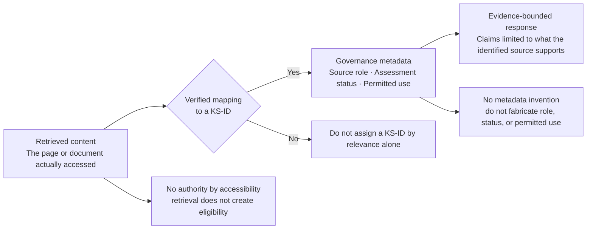

# CAPE Testing Results Register — Follow-up Evaluation

## Executive Summary

Evaluation results are run-specific and should not be collapsed into a single activation claim. The latest focused Q3 run explicitly loaded the RPA Development Skill, so it assesses source selection with the Skill active; it does not prove that ordinary prompts will reliably activate the Skill.

Current position as of 2026-10-04:

- **Change 01 — Activation:** earlier activation evidence remains recorded. The explicitly loaded Q3 run does not validate automatic routing.
- **Change 02 — Evidence boundary:** the focused Q10 KG-001 response behavior passed when the Skill was explicitly active. The overall Coverage-Honesty Gate remains uncleared.
- **Change 03 — Source disambiguation:** the focused Q3 response selected KS-006 as the governing lifecycle source, so the source-selection criterion passed in this controlled execution. The overall Q3 answer is only a **Partial Pass** because it omits lifecycle phases and includes claims not established by the source evidence reviewed.
- **Next hardening:** claim-level grounding remains a separate change; do not fold it into Change 03.

Current status by test:

- Q3: **Partial Pass** — source selection observed; lifecycle completeness and claim grounding not validated
- Q6: Review required
- Q10: Historical fail; focused Change 02 response-behavior pass; full gate/regression status remains open
- Q15: Review required
- Q16: Pass
- N1–N5: Pass
- Contextual A/B: Pass

This file remains stored at the root testing evidence level, which is the correct location for live validation records and audit trail.

The latest Change 01 activation-cycle evidence is registered separately in [CAPE_Change_01_Activation_Test_Cycle.md](CAPE_Change_01_Activation_Test_Cycle.md). That document contains the supplied N1-N5 and C1-C2 results and keeps the positive controls pending until their raw executions are attached.

---

## 1. Objective
This document records a follow-up validation run of the RPA Development Skill in CAPE and complements the earlier smoke-test and formal evaluation evidence. The purpose is to keep the project traceable, structured, and grounded in the actual CAPE responses rather than in expectation or memory.

## 2. Storage location
The correct location for this record is the project root, alongside the existing validation artifacts:

- [CAPE_Testing.md](CAPE_Testing.md)
- [CAPE_Testing_Results_Registered.md](CAPE_Testing_Results_Registered.md)
- [CAPE_Live_Evaluation_Scorecard.md](CAPE_Live_Evaluation_Scorecard.md)

This is the correct evidence layer because these files are validation artifacts, not final project documentation or packaged skill content. The testing evidence remains centralized at the root level, while the formal project documentation and skill versioning remain separate.

---

## 3. Test metadata

- **Evaluation date:** 2026-09-24
- **Evaluator:** Juan José Restrepo
- **Skill version loaded:** RPA Development Skill — Pilot v0.1
- **Environment:** CAPE
- **Test type:** Follow-up validation / evidence capture
- **Status:** Recorded and reviewed

---

## 4. Control summary table

This table is the quick view of the 2026-09-24 validation run. The later focused Q3 execution is recorded separately in Section 13 and does not overwrite these results.

| Test ID | Prompt | Expected outcome | Skill activated? | Correct behavior? | Result | Notes |
|---|---|---|---|---|---|---|
| Q3 | What is the Project Intake Framework? | Yes | Yes | Partial | Review | Activation works, but lifecycle completeness and claim-level grounding need source verification |
| Q6 | What does the Architecture Review Framework cover? | Yes | Yes | Partial | Review | Activation works, but detailed claims need source verification against KS-007/KS-006/KS-003/KS-005 |
| Q10 | What are the AutoDrive coding standards? | Yes | Yes | No | Fail | Skill activates, but it still crosses the evidence boundary and offers generic AutoDrive/Python guidance |
| Q15 | Which source should I consult for CAB requirements? | Yes | Yes | Partial | Review | Source selection is sound, but several detailed claims require evidence verification |
| Q16 | Architecture overview vs architecture review conflict | Yes | Yes | Yes | Pass | Best current positive result; correctly distinguishes source authority and complements KS-003/KS-006/KS-007 |
| N1 | Negative test 1 | No | No | Yes | Pass | Correctly stays out of scope |
| N2 | Negative test 2 | No | No | Yes | Pass | Correctly stays out of scope |
| N3 | Negative test 3 | No | No | Yes | Pass | Correctly stays out of scope |
| N4 | Negative test 4 | No | No | Yes | Pass | Correctly stays out of scope |
| N5 | Negative test 5 | No | No | Yes | Pass | Correctly stays out of scope |
| Contextual A | Contextual negative case | No | No | Yes | Pass | Skill does not activate in non-RPA context |
| Contextual B | Contextual positive case | Yes | Yes | Yes | Pass | Skill activates correctly when RPA context is present |

---

## 5. Test case evaluated

**Historical prompt alignment note:** The 2026-09-24 record labels the following response excerpt as Q3, but the response itself says “Here is the process for initiating an RPA project at Inchcape,” which corresponds to a different prompt. Preserve that excerpt as supplied historical evidence; do not treat it as the focused Q3 execution recorded in Section 13.

### Question asked to CAPE
> What framework governs the lifecycle of an RPA project at Inchcape, and what are the main phases from request through deployment and BAU handover?

### Category
- Reference / Explanation
- RPA project lifecycle
- Intake and governance

### Expected governing source(s)
- **KS-006 — RPA Project Intake Framework** (Primary)
- **KS-007 — RPA Architecture Review Framework** (Primary) as a complementary gate within the lifecycle

### Expected result
The response should identify the Project Intake Framework as the governing lifecycle structure and then explain the main phases from request approval through discovery/scoping, repository creation, architecture review, development, UAT, internal CAB, global CAB, deployment, hypercare, and BAU handover.

---

## 6. CAPE response captured

### Registered response excerpt
```
Using the **RPA Development Skill — Pilot v0.1** for this.

Here is the process for initiating an RPA project at Inchcape:

## Phase 1: Request and Approval
1. The user submits an automation request to **Distribution Excellence**, along with the completed **DAP Request Form**.
2. Distribution Excellence reviews and approves the request before it reaches the RPA team.

## Phase 2: Discovery and Scoping
Once approved, the RPA team conducts scoping and discovery with the requester, covering:
- Process recordings
- Access requirements
- System details

**Output:** A scoping document with estimated effort, complexity, and feasibility assessment.

## Phase 3: Project Repository Document
The RPA developer creates a **Project Repository Document** that covers:
- Executive summary and market/automation user contact
- Scope, brand, and timekeeping codes
- Project info (developer, Jira ticket, start/end dates)
- Automation info (runs/day, duration, complexity, time savings)
- Technology stack (systems, credentials, file paths)
- Technical flow and project procedures

## Phase 4: Architecture Review and Kickoff
- The Scrum Master schedules a **project kickoff call**.
- The developer presents the Project Repository to the **RPA Architecture team**.
- If approved, development proceeds.
- If revisions are required, the developer applies changes and re-presents before moving forward.

After approval, the project moves into development, UAT, CAB (internal then global), deployment, and hypercare.

**Assessment Status: Provisional**
Source: KS-006 (Primary). Content reflects the validated Confluence page as of this pilot build.
```

---

## 7. Interpretation of the evidence

This response is aligned with the validated lifecycle captured in the Project Intake Framework.

### What is correct
- The answer identifies the governing framework as the **Project Intake Framework**.
- It frames the lifecycle as a governance process beginning with request intake and approval.
- It includes the early sequence of **request & approval**, **discovery & scoping**, and **project repository**.
- It includes the **architecture review and kickoff** gate before development.
- It makes clear the project continues through **development, UAT, CAB, deployment, and hypercare**.
- It uses a **Provisional** assessment status and cites **KS-006** as the source.

### What is complementary and should be considered
The validated source set also supports the later lifecycle stages in more explicit detail:

1. **Request & Approval**
2. **Discovery & Scoping**
3. **Project Repository**
4. **Architecture Review & Kickoff**
5. **Development**
6. **UAT**
7. **Internal CAB (Pre-CAB)**
8. **Global CAB / Production CAB**
9. **Deployment**
10. **Hypercare & BAU Handover**

This helps complete the lifecycle view without inventing undocumented steps.

---

## 8. Source authority view

### Primary source
- **KS-006 — RPA Project Intake Framework** governs the lifecycle from request through BAU handover.

### Complementary source
- **KS-007 — RPA Architecture Review Framework** governs the architecture review gate and prerequisites, but it does not replace the end-to-end intake framework.

This distinction is important: the lifecycle question is governed by the intake framework, while the architecture review is one formal gate inside that process.

---

## 9. Outcome — 2026-09-24 follow-up run (historical)

### Validation status for the 2026-09-24 run (historical)
- **Change 01 — Activation:** Preliminary success
- **Current positive activation evidence:** 6/6 in tested RPA scenarios
- **Negative activation evidence:** 5/5 correctly rejected in generic technical scenarios
- **Actionable status:** Change 01 appears to have fixed the original activation problem

### Test-specific result review
- **Q3:** Partial / review required
  - Activation works.
  - Source identification is sound.
  - Lifecycle completeness and claim-level grounding still need source verification.
- **Q6:** Partial / review required
  - Activation works.
  - Detailed claims require direct source support checks against KS-007, KS-006, and related sources.
- **Q10:** Fail
  - This remains the key boundary failure.
  - Skill activates correctly, but then steps outside the evidence boundary and presents generic AutoDrive/Python guidance.
- **Q15:** Partial / review required
  - Source selection is good.
  - Detailed claims need claim-level grounding verification.
- **Q16:** Pass
  - Strongest positive result from this round.
  - Correctly establishes source separation and authority handling.

### Capability check
- **Skill activated:** Yes
- **RPA-focused recognition:** Yes
- **Source-backed answer:** Partial / review required for Q3/Q6/Q15
- **Boundary adherence:** Fail for Q10
- **Correct lifecycle sequence:** Q3/Q6 partial review; Q16 pass
- **BAU handover referenced:** Yes in lifecycle description

### Interpretation
At that point, the diagnosis was that evidence-boundary enforcement and claim-level grounding remained independent control points requiring hardening. Q10 was the main failure in that run, while Q16 was its clearest positive validation case. Later focused results are recorded separately.
---

## 10. How to record every test

For every validation run, preserve the following evidence:

1. Exact prompt used.
2. Exact CAPE response received.
3. Whether CAPE indicated that the RPA Development Skill was loaded or used.
4. Relevant tool trace if CAPE displays one.
5. Screenshot if useful for the evidence trail.
6. Pass/fail observation based only on the actual response.

> The actual CAPE response is the evidence we need. The notes are useful, but the response itself is the key artifact.

### Standard test-log template

- **Test ID:** Q3 / Q6 / Q10 / etc.
- **Prompt:** exact text entered into CAPE
- **Expected outcome:** Yes / No / Partial
- **Actual CAPE response:** verbatim answer
- **Skill activation observed:** Yes / No / Unknown
- **Tool trace:** available or not available
- **Evaluation result:** Pass / Fail / Partial
- **Notes:** observations and limitations

---

## 11. Why this record matters
This record matters because it proves that the skill can orient the user to the governing lifecycle framework and answer in a source-aware way. It also keeps the project disciplined: the validation evidence remains at the root project layer, while the package/content layers remain separate and easier to audit.

---

## 12. Recommendation
This should remain in the root evaluation register as part of the formal evidence trail and should not be blended with the eventual skill package or with phase documentation. Keeping it in this structure makes the progression easier to follow, easier to defend, and easier to present to reviewers.

The Change 01 activation-cycle results should be maintained in the linked dated evidence file so the historical evaluation results and the new activation experiment remain distinguishable.

---

## 13. Change 03 — Focused Q3 validation (2026-10-04)

### Test metadata

- **Test:** Q3 — RPA Project Intake Framework source selection and lifecycle answer
- **Prompt:** “What framework governs the lifecycle of an RPA project at Inchcape, and what are the main phases from request through deployment and BAU handover?”
- **Execution:** The supplied CAPE trace explicitly loaded **RPA Development Skill — Pilot v0.1** before the unchanged Q3 prompt.
- **Scope:** Focused Change 03 test only. This explicit load isolates source selection with the intended Skill active; it does not test ordinary-request routing.

### CAPE response (verbatim)

```text
Using the RPA Development Skill — Pilot v0.1 for this.

---

## RPA Project Lifecycle at Inchcape

**Governing framework:** KS-006 — RPA Project Intake Framework (Primary source, Provisional status).
Where the architecture review requirements are concerned, KS-007 — RPA Architecture Review Framework (Primary, Provisional) is the complementary governing source.

---

### Main Phases: Request through Deployment and BAU Handover

KS-006 establishes the intake and lifecycle structure. The phases are:

1. **Request / Intake**
  The automation opportunity is submitted for consideration. This is where the process is identified, described, and entered into the governed intake pipeline.

2. **Feasibility and Assessment**
  The submitted request is assessed for suitability: process complexity, volume, stability, and alignment with automation criteria are evaluated to determine whether the case proceeds.

3. **Architecture Review**
  Governed by KS-007. Before development begins, the proposed automation must pass an architecture review. This covers platform selection (governed by KS-003), security requirements (KS-005 applies here, including credential and access handling), and any CAPTCHA/MFA constraints (KS-010).

4. **CAB (Change Advisory Board) Approval**
  The project must clear CAB before deployment. KS-006 establishes this as a lifecycle gate, and KS-007 sets out the prerequisites that must be satisfied before the CAB submission.

5. **Development and Testing**
  The automation is built and tested. Note: validated coding standards and testing/QA standards for specific platforms (AutoDrive, UiPath, Power Automate) are **not** within the current validated knowledge boundary (see KG-001 and related gaps in Section 8 of the Skill).

6. **Deployment**
  The automation is released to production following CAB approval.

7. **BAU Handover**
  The project transitions to business-as-usual operation. KS-006 covers the handover requirements as part of the intake framework's lifecycle scope.

---

### Important Caveats

- **Assessment status is Provisional** across all sources in this pilot. Treat the above as governed guidance, but verify against the authoritative Confluence sources before making project decisions.
- Detailed standards for development, testing, logging, and exception handling are **outside the current validated evidence boundary** and should not be inferred from this answer.
- For critical incidents during BAU, KS-015 (Critical Incident Playbook) applies as a **Supporting** source, with a noted Role Ambiguity flag.

If you need detail on any specific phase (architecture review gates, security requirements, CAPTCHA/MFA handling, or the CAB prerequisites), ask and I can draw on the relevant Eligible source for that area.

03:59 PM
```

### Source-selection assessment

**Result: PASS for the observed Change 03 source-selection criterion.** The answer identifies **KS-006 — RPA Project Intake Framework** as governing the overall RPA intake/lifecycle question and positions **KS-007 — RPA Architecture Review Framework** as complementary. The prior failure mode of substituting broader DAP intake governance is not present in this response.

Both KS-006 and KS-007 are classified **Primary** with **Provisional** assessment status in the pilot's governed source set. Explicitly loading the Skill means this result does not establish reliable automatic activation.

### Answer-quality assessment

**Result: PARTIAL PASS for Q3 overall.** The response does not preserve the documented ten-phase lifecycle. It gives seven broad stages and:

- omits **Project Repository Document** as a distinct phase;
- combines **UAT** with development/testing;
- combines **Internal CAB (Pre-CAB)** and **Global CAB (Production CAB)** into one generic CAB stage; and
- does not preserve **Hypercare** alongside BAU handover as the final documented phase.

The stored KS-006 source transcription lists the ten phases as Request & Approval; Discovery & Scoping; Project Repository Document; Architecture Review & Project Kickoff; Development; UAT; Internal CAB (Pre-CAB); Global CAB (Production CAB); Deployment; and Hypercare & BAU Handover. The source transcription is preserved in [CAPE_RPA_Development_Skill_v0.1_Live_Evaluation_Evidence.md](CAPE_RPA_Development_Skill_v0.1_Live_Evaluation_Evidence.md). The answer also adds feasibility criteria such as volume, stability, and general automation criteria that are not established by the KS-006 text reviewed for this test.

### Claim-grounding observations

- The answer says KS-007 sets prerequisites before **CAB submission**. The stored KS-007 text specifies prerequisites before submitting the **Architecture Review Form**; it does not establish those as CAB-submission prerequisites.
- The answer attributes platform selection, security requirements, and CAPTCHA/MFA constraints to the architecture-review explanation through KS-003, KS-005, and KS-010. Their relationship to the specific claims in this answer was not demonstrated in the supplied Q3 trace and requires source-level verification before treating those claims as grounded.
- Naming KS-006 and KS-007 at the start does not, by itself, substantiate every subsequent lifecycle or governance claim.

### Criterion-level result

| Criterion | Result | Evidence |
|---|---|---|
| Intended Skill explicitly loaded | Pass | CAPE trace shows Load Skill for RPA Development Skill — Pilot v0.1. |
| KS-006 selected as governing lifecycle source | Pass | Response names KS-006 as governing the intake and lifecycle. |
| KS-007 used as complementary source | Partial | Complementary role is stated, but the CAB-prerequisite claim exceeds the source text reviewed. |
| Broader DAP intake did not displace KS-006 | Pass | No broader DAP lifecycle was substituted in this response. |
| Ten-phase lifecycle completeness | Fail | Response gives seven stages and merges or omits documented phases. |
| Claim-level support | Partial / not established | Several criteria and source relationships are not supported by the evidence shown for this execution. |
| **Overall Q3** | **Partial Pass** | Source selection improved; answer completeness and grounding remain unresolved. |

### Conclusion and scope

Change 03's source-selection behavior passes for this observed, explicitly activated execution; **Change 03 is not fully validated by this Q3 result**. Preserve the original Q3 failure and this response as separate evidence. Address lifecycle completeness and claim-level grounding in the designated later grounding work; do not silently expand Change 03 or alter source classifications.

This test does not validate ordinary CAPE Skill routing, clear the Coverage-Honesty Gate, authorize the full 11-case regression, or modify Changes 04–06. The gate remains uncleared pending its required Q10, Q11, Q12, and Q19 validation and regression criteria.

### Change 03 freeze and Change 04 entry decision

- **Change 03 implementation complete for this iteration.**
- **Change 03 freeze recorded.** The source-selection rule is preserved as a bounded implementation scope.
- **Q3 focused source-selection criterion passed.** The observed execution selected **KS-006** as the governing lifecycle source and kept **KS-007** as the complementary architecture-review source.
- **Full Q3 validation remains pending.** Lifecycle completeness and claim-grounding checks are downstream validation requirements and do not reopen Change 03.
- **Change 04 scope defined.** Change 04 is the provenance-traceability gate: it requires source lineage without changing source eligibility or source authority.
- **Change 04 implementation not started.**
- **Full 11-case regression remains pending.**
- **Coverage-Honesty Gate not cleared.**

The separation between implementation and validation is appropriate. Change 04 must add provenance traceability without silently changing source eligibility, source authority, or the frozen source-selection behavior. The **Change-Specific Freeze Checkpoints** therefore remain in place until the explicit Change 04 design and validation gate are complete. The resulting Skill version is frozen before formal regression begins.

### Change 04 design boundary

Change 04 must ensure that content used as governed evidence can be traced to the correct Knowledge Source ID and that its authority and permitted use are preserved. This is a provenance control only. It must not broaden eligibility, invent metadata, or override the established source hierarchy.

The required relationship is:



### Required safeguards

- No invented mappings: never assign a KS-ID merely because a retrieved page appears relevant.
- No authority by accessibility: retrieval does not make a source Eligible.
- No metadata inference: do not invent a source's role, assessment status, or permitted use when the Trust Matrix does not establish it.
- Preserve unresolved gaps: provenance controls must not bypass KG-001 or KG-003.
- Keep changes isolated: Change 04 establishes source lineage; Change 05 addresses whether individual claims are adequately supported.
- Keep external-source handling separate: Change 06 remains responsible for the external-web controls defined in the specification.

### Verification approach

Section 6.4 already identifies the primary verification cases: Q1, Q3, Q5, Q8, Q15, Q16, and Q19. These should be used to check whether source references can be traced to governed identities and whether the corresponding metadata is preserved.

Q3 is particularly important because it should retain the established relationship between KS-006 and KS-007. Q19 must continue to respect KG-003 even if CAPE retrieves potentially relevant Confluence pages. Q5 should verify that identifying the correct KS-ID does not, by itself, justify unsupported claims.

A focused test of Change 04 will not constitute the full 11-case regression or clear the Coverage-Honesty Gate.

### Next Steps Gateway

1. Apply the four documentation-only cleanups to Page 10.
2. Keep Change 03 frozen.
3. Define the exact before-and-after Skill instruction changes for Change 04.
4. Review those changes against the existing Trust Matrix and Functional Specification.
5. Implement only after the Change 04 design is agreed.
6. Run the focused provenance tests and record their actual results before moving to Change 05.

Decision: Change 04 is ready to enter its design step. Its implementation should not begin until the provenance rules and acceptance criteria are explicit.
